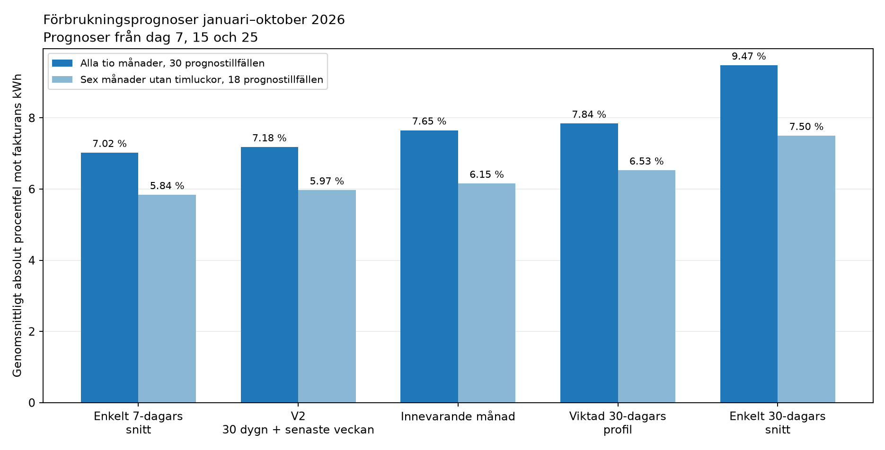
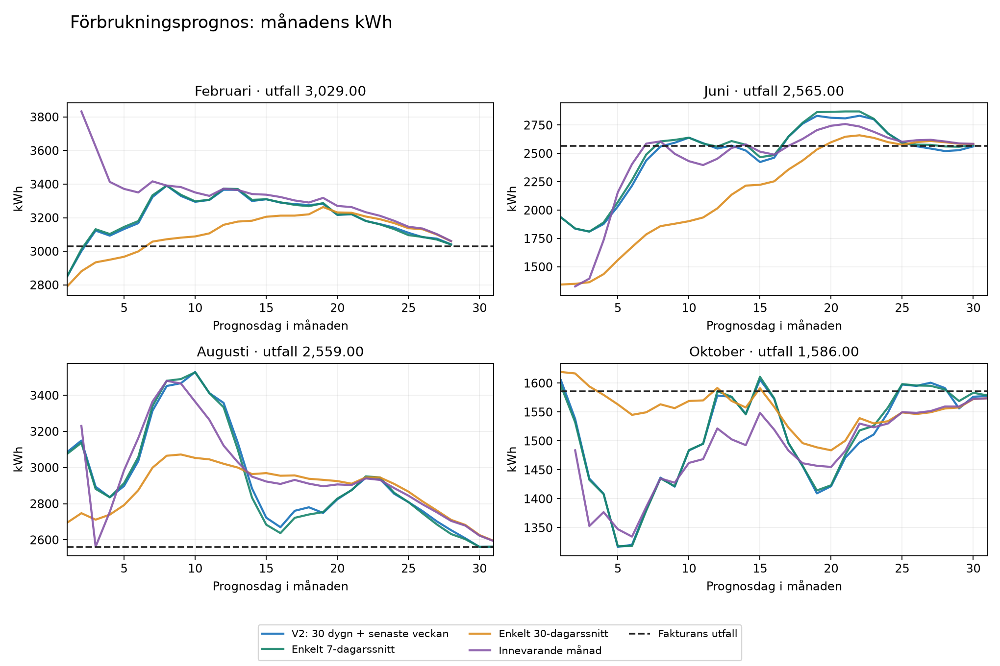
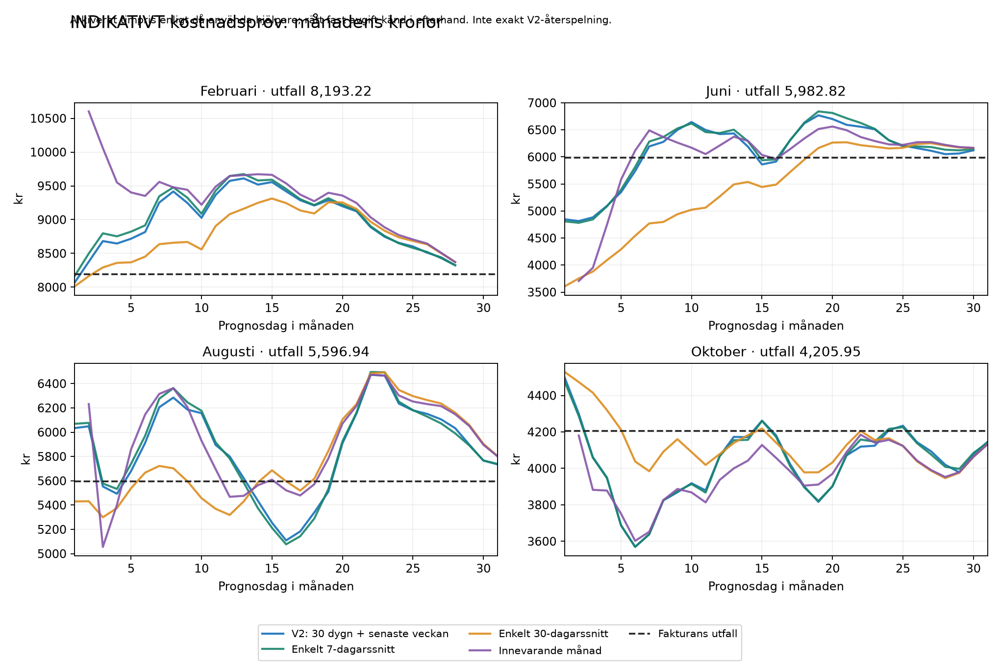

# Elprognoser mot fakturautfall januari–oktober 2026

Analys utförd 9 november 2026, Europe/Stockholm. Fakturorna är facit för
förbrukning och total kostnad. Modellparametrarna har inte optimerats om efter
att det större underlaget lästs in.

## Slutsats

V2 förbättrar det enkla 30-dagarssnittet i detta underlag, framför allt vid
månadsskifte och förändrad lastnivå. Ett enkelt 7-dagarssnitt är dock ungefär
lika bra och något bättre i medel. Skillnaden är för liten och antalet månader
för litet för att fastslå en överlägsen modell. Behåll V2 i parallell drift och
använd även 7-dagarssnitt som jämförelse vid fortsatt utvärdering.

De största säkra förbättringarna just nu är korrekta avgifter, korrekt moms och
rätt månadsfördelning av årsavgifter. Längre detaljhistorik för hela HA behövs
inte för dessa åtgärder.

## Underlag och metod

- Tio registrerade fakturor, januari–oktober 2026.
- Timstatistik för energi och effekt från december 2025 till oktober 2026.
- Arkiverad timstatistik för `sensor.elpris_per_kvart`, alltså priset som
  beräknades med dåvarande hjälpare. Detta är redan ett totalpris per kWh.
- 304 tänkbara dagliga prognosstarter vid lokal midnatt, 303 användbara.
  Den 6 mars blev V2 otillgänglig enligt dess regel om för gammal statistik.
- Huvudjämförelsen använder dag 7, 15 och 25: 30 prognostillfällen. Dag 1 visas
  separat eftersom månadsmodellen då saknar underlag.
- Bara förbrukning och prissensorvärden före prognostidpunkten används för
  träning. Statistikens slutligt lagrade värden används, inte historiska
  korrigeringsversioner eller faktiska mottagningstider.
- V2:s befintliga beräkningsmotor används för lastprofil och luckhantering.
  Femminuters-/kvartfördelning av äldre förbrukning finns inte kvar.
- Juni, juli och oktober användes redan i modellutvecklingen. Det samlade
  materialet är därför inte ett helt oberoende test. Prognoserna från samma
  månad är dessutom korrelerade, inte 30 oberoende månader.

MAPE nedan är medelvärdet av prognosernas absoluta procentavvikelse från
fakturans slutliga kWh. Det är ett uppmätt historiskt fel, inte en framtida
säkerhetsmarginal eller ett konfidensintervall.

## Jämförelse av förbrukningsmodeller

| Modell | Alla tio månader: MAPE | Sex månader utan energiluckor: MAPE | Medel absolut fel, alla månader |
|---|---:|---:|---:|
| Enkelt 7-dagarssnitt | 7,02 % | 5,84 % | 157,34 kWh |
| V2: 30 dygn + veckoadaptering | 7,18 % | 5,97 % | 161,29 kWh |
| Innevarande månads snitt | 7,65 % | 6,15 % | 175,59 kWh |
| Viktad 30-dagarsprofil | 7,84 % | 6,53 % | 178,01 kWh |
| Enkelt 30-dagarssnitt | 9,47 % | 7,50 % | 211,33 kWh |

Sex kompletta månader är januari, februari, maj, juni, juli och oktober.
Jämförelsen på dessa omfattar 18 prognostillfällen. Inom dessa månader ligger
uppmätt månadsenergi och fakturerad energi mindre än 0,36 kWh från varandra,
vilket är förenligt med fakturans avrundning till hela kWh.

### Hur V2 förbättras under månaden

| Prognosstart | Medel absolut procentfel, V2 | Medel absolut fel |
|---|---:|---:|
| Dag 1 | 11,65 % | 261,90 kWh |
| Dag 7 | 11,12 % | 259,94 kWh |
| Dag 15 | 6,71 % | 147,24 kWh |
| Dag 25 | 3,71 % | 76,68 kWh |

Dag 1 ger V2 11,65 % mot 24,25 % för rent 30-dagarssnitt. Underlaget från
föregående månad är alltså användbart, men behöver anpassas när lastnivån ändras.
Den enkla 7-dagarsmodellen ger 11,68 % dag 1, ungefär samma nivå som V2.

### Skillnader mellan månader

Tabellen visar medel absolut procentfel för dag 7, 15 och 25.

| Månad | V2 | 7-dagarssnitt | 30-dagarssnitt | Månadsmodell |
|---|---:|---:|---:|---:|
| 2026-01 | 2,98 % | 2,86 % | 6,56 % | 3,61 % |
| 2026-02 | 7,21 % | 7,18 % | 3,45 % | 8,94 % |
| 2026-03 | 4,23 % | 4,21 % | 12,26 % | 3,40 % |
| 2026-04 | 10,93 % | 10,36 % | 12,22 % | 12,09 % |
| 2026-05 | 8,77 % | 8,87 % | 12,71 % | 7,28 % |
| 2026-06 | 3,91 % | 2,58 % | 14,71 % | 1,42 % |
| 2026-07 | 7,97 % | 8,43 % | 5,92 % | 9,92 % |
| 2026-08 | 15,22 % | 15,05 % | 15,08 % | 18,95 % |
| 2026-09 | 5,61 % | 5,55 % | 10,20 % | 5,14 % |
| 2026-10 | 4,96 % | 5,12 % | 1,65 % | 5,75 % |

V2 klarar exempelvis junis ökade last bättre än ett 30-dagarssnitt. För februari
och oktober är det enkla 30-dagarssnittet bättre. Augusti är svår för samtliga
modeller: den tidiga månadsprognosen ligger tydligt över slututfallet. Detta
visar behov av att reagera på lastförändringar; det belägger inte i sig en
specifik orsak såsom väder, pooldrift eller billaddning.

## Dataluckor

V2 avvisar också den första ackumulerade differensen efter ett statistikhål,
för att den inte ska framstå som en enskild timmes last. Antalet obrukbara
timmar nedan är därför något större än antalet helt saknade timrader.

| Månad | Fakturerat, kWh | Giltig timförbrukning före luckuppskattning, kWh | Ob­rukbara energitimmar |
|---|---:|---:|---:|
| 2026-01 | 3 079 | 3 078,758 | 0 |
| 2026-02 | 3 029 | 3 028,938 | 0 |
| 2026-03 | 2 301 | 2 257,406 | 13 |
| 2026-04 | 1 946 | 1 938,969 | 4 |
| 2026-05 | 1 403 | 1 402,703 | 0 |
| 2026-06 | 2 565 | 2 564,734 | 0 |
| 2026-07 | 2 663 | 2 662,641 | 0 |
| 2026-08 | 2 559 | 2 550,836 | 2 |
| 2026-09 | 1 587 | 1 559,844 | 15 |
| 2026-10 | 1 586 | 1 586,141 | 0 |

En fortsatt förbättring att utvärdera är att använda elmätarens ackumulerade
statistik för energin hittills även över luckor och enbart uppskatta dess
fördelning över timmar. Det bör testas separat innan den aktiva modellen ändras.
Fakturans slututfall har inte använts för att fylla modellernas historiska luckor.

## Kostnadsprovet är indikativt

Det gick inte att få råa historiska spotpriser för hela året via tillgängliga
öppna anrop: Nord Pool returnerade `401 Unauthorized` för flera äldre datum,
och alternativet som provades returnerade 403. Inget abonnemang har tecknats.

Årets jämförelse använder därför det faktiskt arkiverade totalpriset per kWh
från den äldre hjälparbaserade prissensorn, som timvärden. Framtida pris
uppskattas med samma typ av viktad timprofil som V2, från enbart tidigare data.
Ingen framtida prissensorhistorik eller fakturans volymvägda spotpris används
för att förbättra prognosen. Samtliga framtida priser betraktas som okända;
publicerade priser för den aktuella dagen kan inte återställas för hela året.

Fakturans korrekta fasta avgift används **med facit i hand** för att normalisera
just den delen. Varken de historiska individuella hjälparvärdena eller äldre
kvartdata kan spelas tillbaka exakt. Kostnadstestet är därför inte en exakt
återspelning av vad råspotbaserad V2 skulle ha visat, och inte ett fullständigt
bevis för dess historiska kostnadsträffsäkerhet.

| Modell | Indikativt kostnadsfel, medel absolut procentfel |
|---|---:|
| V2: 30 dygn + veckoadaptering | 7,17 % |
| Viktad 30-dagarsprofil | 7,03 % |
| Enkelt 30-dagarssnitt | 8,99 % |
| Enkelt 7-dagarssnitt | 7,20 % |
| Innevarande månads snitt | 7,16 % |

En timapproximation av den äldre kvartprognosen, med dess tiodagarsfönster och
fakturans fasta avgift, ger cirka **8,94 %** vid samma 30 tidpunkter. Det är en
proxy med äldre effekt- och prisstatistik, inte verkligt sparade kvartprognoser.

### Två fel kan råka ta ut varandra

För juni blir arkiverat timpris × uppmätt timenergi + det gamla fasta beloppet
734,64 kr cirka **5 982,91 kr**, nästan identiskt med fakturans **5 982,82 kr**.
Med samma pris-/energiunderlag men fakturans fasta avgift 876,58 kr blir summan
**6 124,85 kr**. Den skenbart perfekta träffen visar alltså inte att alla
komponenter var korrekta. Exakt fördelning mellan prisfel och approximation
inom timmen kan inte fastställas utan äldre råkvartsdata.

### Oktober kan stämmas av bättre

Råa kvartsspotpriser för hela oktober kunde hämtas och jämföras med timenergin.
Med oktoberfakturans avgifter och jämnt fördelad energi inom varje timme fås:

| Oktoberavstämning, inte prognos | Total kostnad |
|---|---:|
| Faktura | 4 205,95 kr |
| Råa spotpriser + fakturans avgifter + timenergi | 4 209,18 kr |
| Samma råpriser, gammal rörlig hjälparavgift, rätt fast avgift | 4 227,02 kr |
| Samma råpriser, gammal rörlig hjälparavgift och 734,64 kr fast | 4 045,67 kr |

Skillnaden med korrekta avgifter är cirka 3,23 kr eller 0,08 %. Resterande
skillnad är förenlig med timfördelning, fakturaavrundningar och avrundade
rörliga avgifter. Detta är en avstämning med kända slutliga priser och tariffer,
inte en prognos som kunnat göras vid månadens början.

## Vad som går att veta om gamla hjälpare

Direkt kontroll av databasen hittar **inga långtidsstatistikserier för
avgiftshjälparna**. Deras sparade tillstånd når vid kontrollen bara tillbaka
till 31 oktober, och varje avgift har ett enda numeriskt värde i det fönstret.
Därför går det inte att belägga vilken individuell hjälparinställning som
användes i varje tidigare månad. Det finns däremot historiska värden för
prissensorn som använde dem, vilka används i det indikativa kostnadsprovet.

Detta är väntat i HA: automatisk långtidsstatistik skapas för lämpliga
sensorer, inte generellt för `input_number`-entiteter.
[Källa: Home Assistants dokumentation](https://www.home-assistant.io/docs/configuration/long-term-statistics/).

Fakturorna ger följande belagda avgiftsförändringar:

- Elnätets årsavgift var 7 080 kr exklusive moms i december 2025 och 8 100 kr
  under de fakturerade månaderna januari–oktober 2026.
- Överföring ändrades från 31,20 till 35,60 öre/kWh vid årsskiftet.
- Energiskatt ändrades från 43,90 till 36,00 öre/kWh vid årsskiftet.
- Elhandelns årsavgift var 432 kr exklusive moms januari–augusti och 528 kr
  från september.
- Elcertifikat debiterades med 1,40 öre/kWh januari–augusti och saknas som
  debiterad post september–oktober.
- Rörliga inköpskostnader varierar månadsvis. De är inte en permanent fast
  tariff även om de representeras av ett justerbart värde i HA.

| Månad | Rörliga inköpskostnader, öre/kWh exkl. moms | Fast avgift elhandel + nät, inkl. moms |
|---|---:|---:|
| 2026-01 | 3,93 | 905,80 kr |
| 2026-02 | 4,13 | 818,14 kr |
| 2026-03 | 3,51 | 905,80 kr |
| 2026-04 | 3,72 | 876,58 kr |
| 2026-05 | 3,81 | 905,80 kr |
| 2026-06 | 3,81 | 876,58 kr |
| 2026-07 | 3,72 | 905,80 kr |
| 2026-08 | 3,83 | 905,80 kr |
| 2026-09 | 3,75 | 886,44 kr |
| 2026-10 | 4,05 | 915,99 kr |

## Rekommenderad fortsättning

Behåll den aktiva förbrukningsmodellen tills vi har oberoende månader i
parallellkörningen. Använd ett 7-dagarssnitt som enkel konkurrent. Prioritera
korrekta tariffer och luckhantering före en mer avancerad modell. Väder- eller
lastspecifika tillägg behöver egna jämförelser; det finns ännu inget test här
som bevisar nyttan av dem.

## Resultatfiler

- [Dagliga prognoser, CSV](elprognos-2026-dagliga-prognoser.csv).
- [Modellfel, SVG](elprognos-2026-modellfel.svg).
- [Förbrukningskurvor, SVG](elprognos-2026-prognoskurvor.svg).
- [Indikativa kostnadskurvor, SVG](elprognos-2026-kostnadskurvor.svg).

Reproducerbart underlag, analyskod och kontroller finns privat i
`backups/elprognos_analys_20261109/`. Fakturaregistret och dess ursprungliga
fakturaposter har inte ändrats av analyserna. Recorders och V2:s automatiska
lagringstider är oförändrade.

## Sista steget: avgifter rättade och verifierade i drift

Avstämning enligt oktoberfakturan, verifierad 2026-11-09T10:33:02.394806+01:00.

| Hjälpare / avgift | Före | Efter / verifierat värde |
|---|---:|---:|
| Rörliga inköpskostnader, exkl. moms | 4,95 öre/kWh | **4,05 öre/kWh** |
| Fast spotpåslag, exkl. moms | 7,00 öre/kWh | 7,00 öre/kWh |
| Elcertifikat, exkl. moms | 0,00 öre/kWh | 0,00 öre/kWh |
| Överföring, exkl. moms | 35,60 öre/kWh | 35,60 öre/kWh |
| Energiskatt, exkl. moms | 36,00 öre/kWh | 36,00 öre/kWh |
| Moms | 25 % | 25 % |
| Fast månadsbelopp inklusive moms | 734,64 kr | **886,44 kr för november** |
| Årsavgift elnät, ny separat hjälpare | — | **8 100 kr exkl. moms** |
| Årsavgift elhandel, ny separat hjälpare | — | **528 kr exkl. moms** |

Summan av rörliga avgifter exklusive spotpris och moms är nu 0,8265 kr/kWh.
Det fasta månadsbeloppet räknas automatiskt från de två årsavgifterna:
respektive årsavgift × månadens dagar / årets dagar, avrundat per nettopost,
och därefter moms. Det ger 915,99 kr i oktober och 886,44 kr i november.
Automationen räknar om vid start, ändring av årsavgift/moms och dagligen vid
midnatt; den skriver bara när beloppet ändras. Hjälparens steg har ändrats
från 10 kr till 0,01 kr.

Oktoberfakturan är **senaste belagda tariff**, inte ett bevis för vilka rörliga
inköpskostnader Vattenfall kommer att debitera i november. Novemberavgiften
ovan förutsätter samma årsavgifter. Inköpskostnaden 4,05 öre/kWh är en senaste
känd uppskattning och behöver stämmas av mot nästa faktura.

### Separat momsrättning i äldre Nordpool-totalpris

Den äldre `sensor.nordpool` hade en `additional_costs`-mall som lade ytterligare
25 procent på en spotdel där integrationen redan hade lagt på moms. Samtidigt
lades avgiftskomponenterna till utan att först bruttoföras. Detta är en annan
mall än `sensor.elpris_per_kvart`, vars momshantering tidigare kontrollerades.

Nordpools extra kostnad är nu endast summan av avgifterna × 1,25, eftersom
integrationen redan momsar spotdelen. Ändringen gjordes med Core stoppad,
med en privat kopia före ändringen och kontroll att alla andra
integrationsuppgifter var identiska. Efter start läses prisintegrationen om
när hjälparna återställts, så att tomma uppstartsvärden inte blir prisunderlag.

Vid slutkontrollen gav publicerat rått spotpris och avgifterna för aktuell
kvart 4,879 kr/kWh; sensorn visade exakt samma avrundade belopp.

V2 sparar framåt även **individuella avgiftskomponenter och årsavgifter** i sin
tariffhistorik. Detta återskapar inte förlorad äldre historik och ändrar inte
HA:s historikgränser. Tidigare pris-/avgiftsobservationer ligger kvar.

### Verifiering

- HA:s konfigurationskontroll godkänd.
- Avgiftsmallen testad för tolv månader 2026 samt februari under skottåret 2028.
- Saknad avgiftskälla stoppar omräkningen i stället för att bli noll.
- Tariffhistoriken klarar äldre poster och fångar ändrade komponenter även när
  totalsumman är oförändrad.
- Momsberäkningen provad med positivt, noll och negativt spotpris.
- Hjälparvärden, årsavgifter och automationsstatus återlästa efter omstart.
- Tio fakturaposter identiska före och efter arbetet.

I HA finns nu **Elpris → Modellanalys 2026**. Den befintliga V2-vyn har fått
uppdaterade testresultat och avgiftskontroller. Andra vyer är bevarade.

Vid morgonkontrollen var nästa dygns priser ännu inte publicerade. Den befintliga Nordpool-tjänsten gav då ett tomt svar som loggades som ett fångat hämtningsfel. V2 fortsatte vara tillgänglig och använde sin märkta prisuppskattning. Loggposten är alltså inte ett bortfall av hela prognosen.
